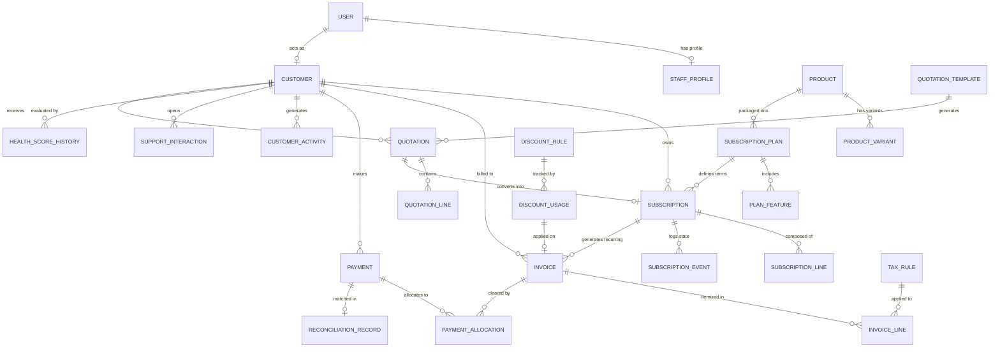

# SUBSIGHT Database Architecture & Schema Specification

**Platform**: SUBSIGHT — AI-Powered Subscription Management & Intelligence Platform  
**Target RDBMS**: PostgreSQL 16 (Compatible with SQLite for local development)  
**ORM**: Django 5.1 ORM with strict Decimal numeric precision  

---

## 1. Architectural Principles

1. **Strict Financial Precision**: All currency amounts, unit prices, tax percentages, and discount values use `DecimalField(max_digits=12, decimal_places=2)`. Floating-point types are strictly prohibited in financial tables.
2. **Immutable Financial Snapshots**: When an invoice is generated from a subscription or a quotation is converted, line item prices, tax rates, and discount deductions are copied verbatim into the target invoice records. Changes to product catalog pricing or tax rules never alter past invoice snapshots.
3. **Compound Idempotency & Unique Constraints**: Duplicate recurring invoices are prevented at the database level with a compound unique constraint on `(subscription_id, billing_period_start, billing_period_end)`.
4. **UUID Identifiers**: Core operational entities (`User`, `Customer`, `Product`, `Subscription`, `Invoice`, `Payment`) utilize UUID primary keys (`UUIDField(primary_key=True, default=uuid.uuid4)`) for secure external references.

---

## 2. Entity-Relationship Overview

---

## 3. Table Schemas & Specifications

### 3.1. Accounts & Authorization (`apps.accounts`)

#### Table: `accounts_user`
| Field | Type | Modifiers / Constraints | Description |
|---|---|---|---|
| `id` | UUID | Primary Key, default=uuid4 | Unique user ID |
| `email` | VARCHAR(255) | Unique, indexed | Primary login identifier |
| `first_name` | VARCHAR(150) | Not null | User first name |
| `last_name` | VARCHAR(150) | Not null | User last name |
| `role` | VARCHAR(20) | Choices: `ADMIN`, `STAFF`, `CUSTOMER` | User role for RBAC |
| `is_active` | BOOLEAN | Default=True | Account state |
| `is_staff` | BOOLEAN | Default=False | Django admin access |
| `created_at` | TIMESTAMPTZ | auto_now_add=True | Registration timestamp |
| `updated_at` | TIMESTAMPTZ | auto_now=True | Last update |

#### Table: `accounts_staffprofile`
| Field | Type | Modifiers / Constraints | Description |
|---|---|---|---|
| `id` | BIGINT | Primary Key, Auto-increment | Staff record ID |
| `user_id` | UUID | FK -> `accounts_user(id)`, Unique | 1:1 user link |
| `department` | VARCHAR(100) | Nullable | e.g., Operations, Finance, Billing |
| `phone_number` | VARCHAR(30) | Nullable | Contact number |

---

### 3.2. Customers (`apps.customers`)

#### Table: `customers_customer`
| Field | Type | Modifiers / Constraints | Description |
|---|---|---|---|
| `id` | UUID | Primary Key, default=uuid4 | Customer unique ID |
| `user_id` | UUID | FK -> `accounts_user(id)`, Unique | Linked login user |
| `company_name` | VARCHAR(255) | Indexed, Not null | Business or corporate entity name |
| `billing_email` | VARCHAR(255) | Not null | Invoice delivery destination |
| `phone` | VARCHAR(50) | Nullable | Contact telephone |
| `address_line1` | VARCHAR(255) | Nullable | Street address |
| `city` | VARCHAR(100) | Nullable | City |
| `state` | VARCHAR(100) | Nullable | State or province |
| `country` | VARCHAR(100) | Default='India' | Country name |
| `postal_code` | VARCHAR(20) | Nullable | Postal code |
| `tax_identifier` | VARCHAR(50) | Nullable | GSTIN, VAT, or EIN |
| `credit_limit` | DECIMAL(12,2) | Default=0.00 | Maximum credit allowance |
| `payment_terms_days` | INTEGER | Default=30 | Payment term days (Net 15, 30, etc.) |
| `created_at` | TIMESTAMPTZ | auto_now_add=True | Creation date |

---

### 3.3. Products & Variants (`apps.products`)

#### Table: `products_product`
| Field | Type | Modifiers / Constraints | Description |
|---|---|---|---|
| `id` | UUID | Primary Key, default=uuid4 | Product ID |
| `name` | VARCHAR(255) | Indexed, Not null | Product title |
| `product_type` | VARCHAR(50) | Choices: `SOFTWARE`, `SERVICE`, `ADDON` | Type classification |
| `sales_price` | DECIMAL(12,2) | Not null | Base selling price |
| `cost_price` | DECIMAL(12,2) | Default=0.00 | Internal product cost |
| `description` | TEXT | Blank/Null | Product documentation / notes |
| `status` | VARCHAR(20) | Choices: `ACTIVE`, `ARCHIVED` | Status |

#### Table: `products_productvariant`
| Field | Type | Modifiers / Constraints | Description |
|---|---|---|---|
| `id` | UUID | Primary Key, default=uuid4 | Variant ID |
| `product_id` | UUID | FK -> `products_product(id)` | Parent product |
| `name` | VARCHAR(100) | Not null | Variant name (e.g., Standard, Premium, Odoo) |
| `sku` | VARCHAR(100) | Unique, Indexed | Stock Keeping Unit identifier |
| `price_adjustment`| DECIMAL(12,2) | Default=0.00 | Differential added to base price (+₹560) |
| `is_active` | BOOLEAN | Default=True | Variant active flag |

---

### 3.4. Subscription Plans (`apps.plans`)

#### Table: `plans_subscriptionplan`
| Field | Type | Modifiers / Constraints | Description |
|---|---|---|---|
| `id` | UUID | Primary Key, default=uuid4 | Plan ID |
| `name` | VARCHAR(255) | Not null | Plan title |
| `product_id` | UUID | FK -> `products_product(id)` | Associated base product |
| `billing_frequency`| VARCHAR(20)| Choices: `DAILY`, `WEEKLY`, `MONTHLY`, `YEARLY` | Cadence interval |
| `price` | DECIMAL(12,2) | Not null | Plan recurring price |
| `min_quantity` | INTEGER | Default=1 | Minimum seats / units |
| `available_from` | DATE | Default=now | Availability start date |
| `available_until`| DATE | Nullable | End of commercial availability |
| `pause_permission`| BOOLEAN | Default=True | Customer pause allowed |
| `early_closure_permission`| BOOLEAN | Default=True | Customer cancellation allowed |
| `renewal_permission`| BOOLEAN | Default=True | Self-service renewal allowed |
| `status` | VARCHAR(20) | Choices: `ACTIVE`, `ARCHIVED` | Plan status |

---

### 3.5. Quotations (`apps.quotations`)

#### Table: `quotations_quotation`
| Field | Type | Modifiers / Constraints | Description |
|---|---|---|---|
| `id` | UUID | Primary Key, default=uuid4 | Quotation ID |
| `quotation_number`| VARCHAR(64) | Unique, Indexed | Format: `QUO-YYYYMM-XXXX` |
| `customer_id` | UUID | FK -> `customers_customer(id)` | Customer link |
| `status` | VARCHAR(20) | Choices: `DRAFT`, `SENT`, `ACCEPTED`, `DECLINED`, `EXPIRED`, `CONVERTED` |
| `subtotal` | DECIMAL(12,2) | Default=0.00 | Sum of line subtotals |
| `tax_amount` | DECIMAL(12,2) | Default=0.00 | Computed tax |
| `discount_amount`| DECIMAL(12,2) | Default=0.00 | Computed discount |
| `total_amount` | DECIMAL(12,2) | Default=0.00 | Net payable total |
| `valid_until` | DATE | Not null | Expiration cutoff date |
| `notes` | TEXT | Blank/Null | Quotation terms & memo |

---

### 3.6. Subscriptions & Lifecycle (`apps.subscriptions`)

#### Table: `subscriptions_subscription`
| Field | Type | Modifiers / Constraints | Description |
|---|---|---|---|
| `id` | UUID | Primary Key, default=uuid4 | Subscription ID |
| `subscription_number`| VARCHAR(64) | Unique, Indexed | Format: `SUB-YYYYMM-XXXX` |
| `customer_id` | UUID | FK -> `customers_customer(id)` | Customer |
| `plan_id` | UUID | FK -> `plans_subscriptionplan(id)` | Active plan |
| `status` | VARCHAR(20) | Choices: `DRAFT`, `QUOTATION`, `CONFIRMED`, `ACTIVE`, `PAUSED`, `CLOSED` | State |
| `billing_frequency`| VARCHAR(20)| Choices: `DAILY`, `WEEKLY`, `MONTHLY`, `YEARLY` | Derived from plan |
| `start_date` | DATE | Not null | Effective start |
| `expiry_date` | DATE | Nullable | Final contract expiry |
| `next_billing_date`| DATE | Indexed, Not null | Celery Beat billing trigger |
| `auto_renew` | BOOLEAN | Default=True | Automatic renewal switch |
| `subtotal` | DECIMAL(12,2) | Default=0.00 | Total periodic line sum |
| `tax_amount` | DECIMAL(12,2) | Default=0.00 | Total recurring tax |
| `discount_amount`| DECIMAL(12,2) | Default=0.00 | Total recurring discount |
| `total_amount` | DECIMAL(12,2) | Default=0.00 | Net recurring cycle price |

#### Table: `subscriptions_subscriptionevent`
| Field | Type | Modifiers / Constraints | Description |
|---|---|---|---|
| `id` | UUID | Primary Key, default=uuid4 | Event log ID |
| `subscription_id`| UUID | FK -> `subscriptions_subscription(id)` | Target subscription |
| `event_type` | VARCHAR(50) | e.g., `CREATED`, `ACTIVATED`, `PAUSED`, `RESUMED`, `UPGRADED`, `CLOSED` |
| `notes` | TEXT | Blank/Null | Context notes and actor attribution |
| `created_at` | TIMESTAMPTZ | auto_now_add=True | Audit timestamp |

---

### 3.7. Invoices (`apps.invoices`)

#### Table: `invoices_invoice`
| Field | Type | Modifiers / Constraints | Description |
|---|---|---|---|
| `id` | UUID | Primary Key, default=uuid4 | Invoice ID |
| `invoice_number` | VARCHAR(64) | Unique, Indexed | Format: `INV-YYYYMM-XXXX` |
| `customer_id` | UUID | FK -> `customers_customer(id)` | Customer link |
| `subscription_id`| UUID | FK -> `subscriptions_subscription(id)`, Nullable | Origin subscription |
| `billing_period_start`| DATE | Nullable | Cycle start |
| `billing_period_end` | DATE | Nullable | Cycle end |
| `invoice_date` | DATE | Not null | Generation date |
| `due_date` | DATE | Not null | Payment due date |
| `subtotal` | DECIMAL(12,2) | Default=0.00 | Line items subtotal |
| `discount_amount`| DECIMAL(12,2) | Default=0.00 | Applied coupon deduction |
| `taxable_amount` | DECIMAL(12,2) | Default=0.00 | `subtotal - discount_amount` |
| `tax_amount` | DECIMAL(12,2) | Default=0.00 | Snapshot tax |
| `total_amount` | DECIMAL(12,2) | Default=0.00 | `taxable_amount + tax_amount` |
| `amount_paid` | DECIMAL(12,2) | Default=0.00 | Aggregated verified payments |
| `balance_due` | DECIMAL(12,2) | Default=0.00 | `total_amount - amount_paid` |
| `status` | VARCHAR(20) | Choices: `DRAFT`, `CONFIRMED`, `PAID`, `CANCELLED` | Lifecycle state |

**Unique Constraint**:
`UNIQUE (subscription_id, billing_period_start, billing_period_end)` guarantees idempotent billing runs.

---

### 3.8. Payments & Reconciliation (`apps.payments`)

#### Table: `payments_payment`
| Field | Type | Modifiers / Constraints | Description |
|---|---|---|---|
| `id` | UUID | Primary Key, default=uuid4 | Payment ID |
| `payment_number` | VARCHAR(64) | Unique, Indexed | Format: `PAY-YYYYMM-XXXX` |
| `customer_id` | UUID | FK -> `customers_customer(id)` | Customer |
| `invoice_id` | UUID | FK -> `invoices_invoice(id)` | Settled invoice |
| `amount` | DECIMAL(12,2) | Not null | Payment sum |
| `payment_method` | VARCHAR(30) | Choices: `BANK_TRANSFER`, `CREDIT_CARD`, `UPI`, `CASH`, `OTHER` |
| `payment_date` | DATE | Not null | Receipt date |
| `transaction_reference`| VARCHAR(100)| Indexed, Not null | Bank UTR, Card Auth, or UPI Ref |
| `status` | VARCHAR(20) | Choices: `PENDING`, `COMPLETED`, `FAILED`, `REFUNDED` |

#### Table: `payments_reconciliationrecord`
| Field | Type | Modifiers / Constraints | Description |
|---|---|---|---|
| `id` | UUID | Primary Key, default=uuid4 | Statement record ID |
| `bank_statement_reference`| VARCHAR(100)| Indexed | Reference from uploaded bank feed |
| `statement_date` | DATE | Not null | Transaction date on statement |
| `statement_amount` | DECIMAL(12,2)| Not null | Statement credit amount |
| `matched_payment_id` | UUID | FK -> `payments_payment(id)`, Nullable | Linked confirmed payment |
| `status` | VARCHAR(20) | Choices: `UNMATCHED`, `AUTO_MATCHED`, `MANUAL_VERIFIED`, `FLAGGED_REVIEW` |

---

### 3.9. Subscription Intelligence & Health Score (`apps.intelligence`)

#### Table: `intelligence_customerhealthscore`
| Field | Type | Modifiers / Constraints | Description |
|---|---|---|---|
| `id` | UUID | Primary Key, default=uuid4 | Score record ID |
| `customer_id` | UUID | FK -> `customers_customer(id)` | Evaluated customer |
| `health_score` | INTEGER | Check: 0 <= score <= 100 | Composite health index |
| `category` | VARCHAR(20) | Choices: `HEALTHY`, `NEEDS_ATTENTION`, `AT_RISK` | Tier classification |
| `payment_score` | INTEGER | Check: 0 <= score <= 100 | On-time payment index |
| `renewal_score` | INTEGER | Check: 0 <= score <= 100 | Historical renewal rate |
| `usage_score` | INTEGER | Nullable | Telemetry product usage |
| `engagement_score` | INTEGER | Nullable | Admin logins / user engagement |
| `support_score` | INTEGER | Nullable | Support ticket sentiment / volume |
| `data_coverage_pct` | INTEGER | Check: 0 <= score <= 100 | % of 5 signals available |
| `calculated_at` | TIMESTAMPTZ | auto_now=True | Last calculation timestamp |

---

### 3.10. Revenue Intelligence (`apps.revenue`)

#### Table: `revenue_revenuescenario`
| Field | Type | Modifiers / Constraints | Description |
|---|---|---|---|
| `id` | UUID | Primary Key, default=uuid4 | Scenario ID |
| `name` | VARCHAR(100) | Not null | Scenario name (e.g. Q4 Price Increase) |
| `growth_rate_pct` | DECIMAL(5,2) | Default=0.00 | Projected new subscriber % |
| `churn_rate_pct` | DECIMAL(5,2) | Default=0.00 | Projected subscriber drop % |
| `price_change_pct` | DECIMAL(5,2) | Default=0.00 | Catalog price shift % |
| `discount_pct` | DECIMAL(5,2) | Default=0.00 | Campaign discount rate % |
| `new_customers_count`| INTEGER | Default=0 | Absolute new customer additions |
| `projected_mrr` | DECIMAL(12,2) | Default=0.00 | Month 12 projected MRR |
| `projected_arr` | DECIMAL(12,2) | Default=0.00 | Projected ARR |
| `created_by_id` | UUID | FK -> `accounts_user(id)` | Admin creator |
